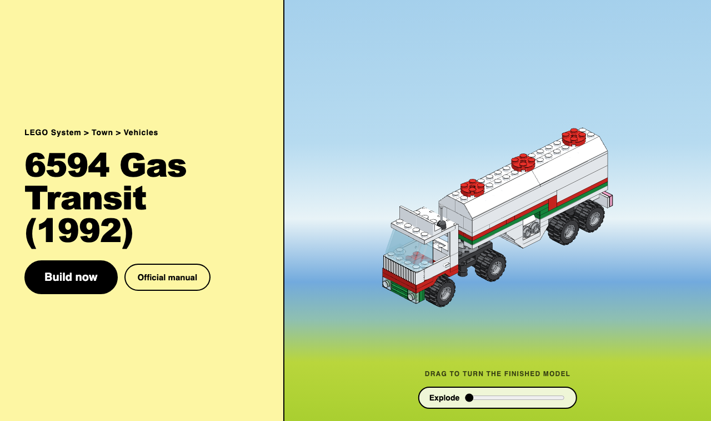

# 6594 Gas Transit (1992): 3D Build Guide

## Model data

- [LDraw Official Model Repository, set page](https://library.ldraw.org/omr/sets/1359): the page for set 6594-1.
- [6594-1.mpd model file](https://library.ldraw.org/media/omr_models/1673/6594-1.mpd?v=1758937657): the part list and positions, by Iván Sánchez Ortega (CC BY 2.0).
- [LDraw parts library, GitHub mirror](https://github.com/gkjohnson/ldraw-parts-library): the shape of every part and the LDraw colour table, fetched from its `complete/ldraw/` folder.

## Set information

- [Brickset: 6594 Gas Transit](https://brickset.com/sets/6594-1/Gas-Transit): the name, year (1992), and theme and subtheme (Town, Vehicles). The "Official manual" button and the side-panel link also point here.

## Photoreal render

- [ImportLDraw](https://github.com/TobyLobster/ImportLDraw): the Blender add-on used to import the model and set up the scene (GPL 2).

## The result

- [6594 Gas Transit (1992): 3D Build Guide](https://claude.ai/artifact/79jdpFSpGCvUUsxADV42v3): the published page.

## Used without a link

- `three` and `esbuild` from npm, for the web page.
- `bpy` (Blender 5.3 as a Python module) from PyPI, for the render.
- The step order came from two scans of the printed instruction sheet, supplied as images.
- The Tow tray model came from hand-drawn schematic images, supplied as images.
